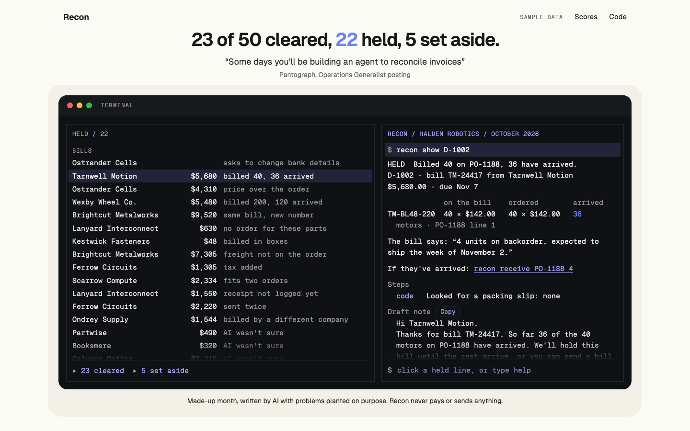
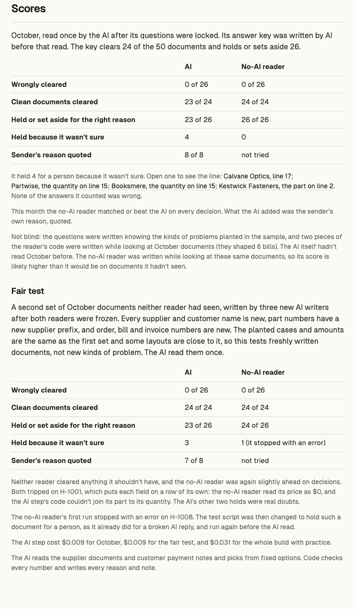

# Recon

Recon checks a month of supplier bills and customer payments for a made-up robot maker, from the terminal. It clears what matches the orders and what arrived, holds the rest with a one-line reason and a drafted note, and never pays or sends anything.

Pantograph's Operations Generalist posting says “Some days you’ll be building an agent to reconcile invoices”. This is my version of that, on sample data.

**The page:** https://duckky153.github.io/recon/



## Try it

```
./recon load                     # build recon.db from sample/
./recon run --month 2026-10      # decide October from the saved AI answers
./recon held                     # what was held, one line each
./recon show D-1002              # the bill, the order, what arrived, the supplier's own words, a drafted note
./recon receive PO-1188 4        # the 4 late motors arrive: the bill is checked again and clears
./recon reset                    # undo that
./recon held --json              # every command has --json; errors exit 1 with {"error", "code"}
```

Python 3.9 or later (tested on 3.9 and 3.12), standard library only. `./run.sh` runs every test; it also needs Node for the page's rules.

## What it checks

The rules are in `rules.json` (`./recon rules` prints them):

- Never pay for more than has arrived: what is billed on an order line can't exceed what was received on it.
- A unit price more than 2% over the order, or more than $50 over on a line, is held, unless someone logged the new price. Under the order clears with a note.
- Freight not on the order is held over $100. Tax on an order that expected none is held. Every line's quantity times price must equal its amount, and the lines, freight and tax must equal the total, to the cent.
- A bill from a company other than the one the order was placed with is never cleared. A request to change bank details is flagged.
- A payment must name its invoice and match it to the cent. One that names none is held, with the matching open invoice suggested.
- The company's own invoices are checked against their sales orders and what was delivered by the day they went out.

Before holding, it looks further: a price change someone logged, a packing slip in the inbox, the maker behind a distributor's bill, the return behind a credit. Each step shows in `show`. A cleared bill is ready for a person to pay; a cleared payment or invoice matches.

## What's AI here, and what isn't

One step uses AI. Jev, TypeSafe's model, reads each supplier document and payment note. It only picks from options code wrote (`questions.json`), such as a line's quantity or which invoice a payment names. It writes no text and does no arithmetic.

Every document is read twice, the second time with every list of options reversed. An answer counts only when both reads pick the same option and are past its threshold: 0.90 for numbers, parts, orders and calling something a bill; 0.70 for calling it another kind of document; 0.80 for what a line lists and for yes-or-no answers. Where only one part or order is possible, the yes-or-no answer decides it. Code fills in three things itself: the order by quantity when the AI isn't sure, a total equal to the lines' sum when the AI is split between that and "no total", and a unit taken from the order when the AI is unsure of it or none is printed. Quoting the sender's own line needs 0.50 and never holds a document. Anything else uncertain holds the document for a person.

Everything that decides is plain code: `recon_core.py`, with the rules in `rules.json` and every reason and note written from `wording.json`. When the AI isn't sure which order a line is for, code compares the quantity with what is still open on each order. The page runs the same rules in the browser (`site/rules.js`); a test checks that both give the same answers on 54 cases, including both readers' saved answers and odd readings the AI could give.

## How it was tested

- **Sample data.** `sample/make_books.py` makes the books. The 72 documents (a practice month and October; the fair test below adds 42) were written by AI from written rules (`sample/WRITING-RULES.md`), one slot each, and `sample/check_docs.py` checks every value against the books. Problems are planted so each kind shows up at least once; a real month would have far fewer. The answer key is each slot's keyed outcome, written by AI before any AI read.
- **Practice.** The thresholds and questions were tuned on September, in two reads; the changes are listed in `questions.json` and `CHANGES.md`.
- **Not blind to October.** The questions were written knowing the kinds of problems planted in the sample, and among the documents the AI reads, October has 14 kinds of case September doesn't. Two pieces of the reader's code were written while I was looking at October documents: joining a part number printed alone on a line with the numbers on the next line, and picking the order by quantity when the AI isn't sure. Those shaped 6 October bills (D-1008, D-1012, D-1022, D-1024, D-1027, D-1031). The AI itself never read October before the scored read.
- **Frozen, then read once.** Before the one read of October, every file it depends on was fingerprinted in `lock.json`. That covers the questions, reader, rules, wording, deciding code, scorer, no-AI reader, books, key and documents. Changes since are logged there; none changed a score.

October, 50 documents (42 read by the AI, 8 of the company's own invoices checked by code). The key clears 24 and holds or sets aside 26:

| | AI | No-AI reader |
|---|---|---|
| Wrongly cleared | 0 of 26 | 0 of 26 |
| Clean documents cleared | 23 of 24 | 24 of 24 |
| Held or set aside for the right reason | 23 of 26 | 26 of 26 |
| Held because it wasn't sure | 4 | 0 |
| Sender's reason quoted | 8 of 8 | not tried |



- This month the no-AI reader matched or beat the AI on every decision. What the AI added was the sender's own reason, quoted, without a text pattern written for each layout.
- Where the AI wasn't sure, it held the document for a person. D-1012: is the supplier's note line a charge? (The reader had joined that line to the subtotal line below it.) D-1018 and D-1019: is “1” on a monthly plan a quantity? D-1025: are boxes of screws the part on the order? None of the answers it counted was wrong, and the two reads never picked different options (0 of 378; the 142 yes-or-no answers agreed too).
- The no-AI reader (`baseline.py`) uses exact part numbers and fixed text patterns. It was written while looking at these same documents, so its score is likely higher than it would be on documents it hadn't seen.
- `score.py` writes `scores.json`; the AI's answers are in `answers/`, so `./recon run` works from a fresh copy with no key.
- The AI step cost $0.009 for October.

### Fair test

A second set of October documents neither reader had seen (`holdout/`). Every supplier and customer name is new; part numbers get a new supplier prefix (OC-LFP-2420 became PL-LFP-2420); order, bill and invoice numbers get new digits; the senders' explaining lines are reworded. Three new AI writers wrote the 42 documents from the slots and the writing rules only, after both readers were frozen, and none of them saw the first set (their brief: `holdout/WRITER-BRIEF.md`). The planted cases and amounts are the same as the first set, so the answer key carries over, and some layouts came out close to the first set's: this tests freshly written documents, not new kinds of problem. The sample was fingerprinted in `holdout/lock.json` and committed before either reader read it, and the AI read it once (`holdout/run_holdout.py`).

| | AI | No-AI reader |
|---|---|---|
| Wrongly cleared | 0 of 26 | 0 of 26 |
| Clean documents cleared | 24 of 24 | 24 of 24 |
| Held or set aside for the right reason | 23 of 26 | 24 of 26 |
| Held because it wasn't sure | 3 | 1 (it stopped with an error) |
| Sender's reason quoted | 7 of 8 | not tried |

- Neither reader cleared anything it shouldn't have, and both cleared every clean document. As in October, the no-AI reader was slightly ahead on decisions: the AI did better on H-1008, the no-AI reader on H-1012 and H-1019, and both missed the reason on H-1001.
- H-1001 puts each field of its one line on a row of its own. The no-AI reader read the price as $0. The AI's answers that caused the hold were sure, but the AI step's code couldn't join the part to its quantity, so it held the bill as not sure. Both held it for a person.
- The AI's other two holds were real doubts: whether "1" on a monthly plan is a quantity (H-1019), and whether the supplier's note line is a charge (H-1012). It missed one sender's reason (H-1007, still held for the right reason).
- The no-AI reader's first run stopped with an error on H-1008 (a quantity printed as "6 EA") and wrote nothing. The test script was then changed to hold a document a reader stops on, as it already held a broken AI reply, and the no-AI reader was run again, before the AI read. The reader itself was not changed.
- The two reads picked different options once in 382 picks (which order a line on H-1022 was for); that answer didn't count, and the bill was held for the right reason. The 143 yes-or-no answers agreed too.
- The AI step cost $0.009 for the fair test, and $0.031 for the whole build with practice.

## What I'd change next

- Hold a document only when the field the AI is unsure of could change the outcome; in October, three of the four held as "not sure" couldn't have.
- Join a line whose fields are each on a row of their own, the layout that tripped both readers on H-1001.
- Test on a month with different kinds of problem. The fair test changed the names and the documents, not the cases.

## Limits

- Sample data only. It has never run on anyone's books.
- Fee lines (setup, tooling) aren't read as lines, so a bill with one is held for a person to check.
- Tax and freight are checked against the bill's first order only. Supplier statements are set aside, not reconciled line by line.
- No due dates or payment run: it doesn't net credits against bills or make a list of what to pay.
- An invoice sent before delivery is held, even where a customer agreed to a deposit.
- It reads text, not images or scans, and doesn't learn from what a person decides.

## Files

`recon` (the command), `recon_core.py` (the deciding code), `rules.json`, `wording.json`, `questions.json`, `ai_read.py` (the AI step), `baseline.py`, `score.py`, `scores.json`, `lock.json`, `answers/`, `sample/`, `holdout/` (the fair test), `site/` (the page), `tests/`, `run.sh`, `CHANGES.md`.
